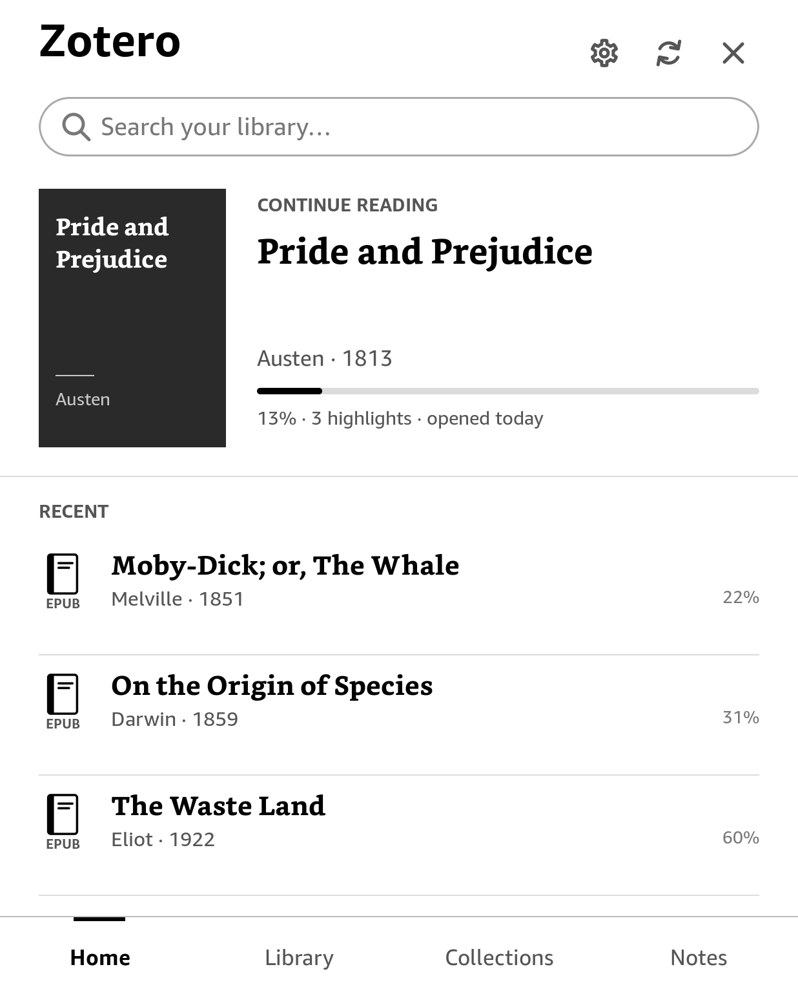
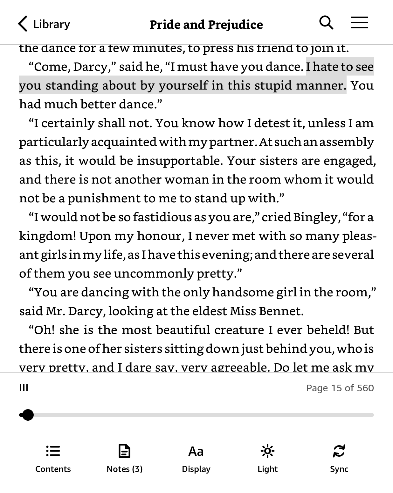
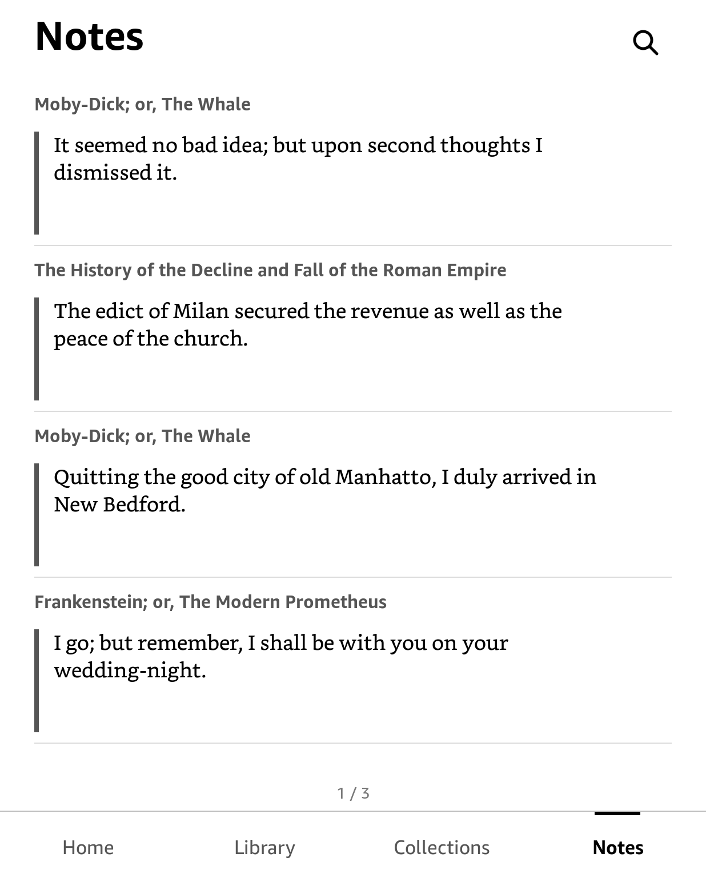
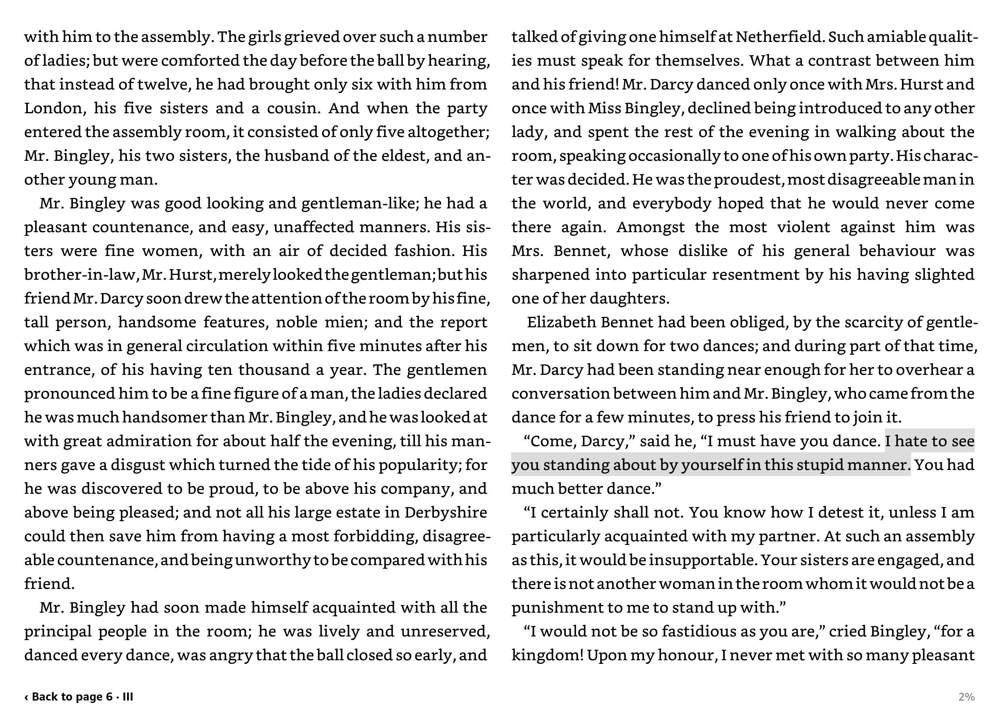

<h1 align="center">Zotero for Kindle</h1>

  Your Zotero library on a jailbroken Kindle. 
  Read your PDFs and EPUBs, highlight and annotate, and everything syncs back to Zotero.

  <a href="https://github.com/ievlevpn/zotero-for-kindle/releases/latest">Download</a> ·
  <a href="INSTALL.md">Install</a> ·
  <a href="docs/plugins/using.md">Plugins</a>

<table align="center">
  <tr>
    <td align="center"> Home</td>
    <td align="center"> Reading</td>
    <td align="center"> Reading menu</td>
    <td align="center"> Highlights and notes</td>
  </tr>
  <tr>
    <td align="center" colspan="4"> Kindle Scribe, landscape, two columns</td>
  </tr>
</table>

> **Unofficial.** A personal project, built for my own use; not made or supported by Zotero or Amazon. It works on my
> Kindles — it may not work on yours.

## What it does

**Your library, on the Kindle.** Items, collections and tags sync from zotero.org. Browse, search the whole library
or one collection, pin collections, mark books read (a Zotero tag of your choice). Books download on demand from Zotero
storage or WebDAV — or keep a whole collection downloaded, and new papers in it arrive by themselves.

**A reader made for e-ink.** EPUB and PDF, with fonts, sizes and margins, PDF margin trimming, landscape with two
columns on big screens, footnotes in a pop-up, bookmarks, *Go to page*, and Fast reading fonts for EPUBs.

**Annotations that go both ways.** Highlights, underlines and comments; on PDFs also **areas** (a box around a figure,
a formula or a table) and **sticky notes** in the margin. They appear in Zotero desktop, and Zotero's appear here.

**Write with the Scribe's pen.** On a Kindle Scribe the pen writes straight onto PDF pages; strokes become Zotero ink
annotations. The eraser end takes them away, and a palm resting on the screen is ignored. Contributed by Anna
Smirnova — details in [docs/scribe-pen.md](docs/scribe-pen.md).

**Plugins.** Small JavaScript plugins add what doesn't belong in the app itself — an action on selected text, a
screen of their own, work after a sync. *Settings → Plugins → Get plugins* lists the catalog; the first plugin is
[Feed Riffle](https://github.com/ievlevpn/zk-feed-riffle), which deals the new papers from your Zotero feeds as cards
to keep or discard. [More below](#plugins).

**Easy on the battery.** The app rests while you read, never turns Wi-Fi on by itself, and updates itself from
*Settings → Check for updates* (signed releases; a version that doesn't start is rolled back).

## Requirements

- **A jailbroken Kindle** that can run scriptlets (`.sh` files in `documents/` show up in the library); most
  jailbreaks provide this through the Universal Hotfix — see [kindlemodding.org](https://kindlemodding.org).
  Tested on a Paperwhite 5 (firmware 5.18.4) and a Kindle Scribe (5.16.8).
- **A Zotero account and an API key** from [zotero.org/settings/keys](https://www.zotero.org/settings/keys).
- **Your files in Zotero storage or on WebDAV** — where Zotero desktop syncs them (*Settings → Sync → File Syncing*).

## Install

The easiest way is with an AI agent: connect the Kindle by USB, then give Claude Code, Codex or a similar agent this
prompt:

> Install Zotero for Kindle on my Kindle by following
> https://github.com/ievlevpn/zotero-for-kindle/blob/master/INSTALL-WITH-AI.md

To do it yourself, see [INSTALL.md](INSTALL.md) — it amounts to copying two folders over USB. After that, updates come
from *Settings → Check for updates* on the Kindle.

## Plugins

A plugin can add an action to the reader's selection bar or to an item's page, open screens of its own (drawn by the
app, in its own style), and run in the background after a sync. Get one from *Settings → Plugins → Get plugins*, or
copy its folder into `zotero/plugins/` over USB.

They're kept on a short leash:

- **Off until you say so** — a plugin stays off until you've read what it may do and turned it on.
- **Changes go through the app** — it checks every change, and nothing is removed without asking you each time.
- **Signed** — catalog plugins by their authors, the catalog itself by the app.
- **Easy to turn off** — one that keeps failing turns itself off; a file named `OFF` in the plugins folder turns them
  all off.

For people writing plugins: [Using plugins](docs/plugins/using.md) ·
[Getting started](docs/plugins/getting-started.md) · [API reference](docs/plugins/reference/README.md) ·
[Publishing](docs/plugins/publishing.md) · examples in [sdk/examples](sdk/examples).

## Building from source

C++20 with cairo/pango, crengine (EPUB), MuPDF (PDF) and FBInk, built with Meson.

    meson setup build-desktop && meson compile -C build-desktop   # desktop build (macOS)
    ./build-desktop/tests/zk-tests                                # the tests
    ./build-desktop/zotero --device pw5                           # try it in a window (or --device scribe)
    tools/build-kindle.sh                                         # cross-build in the zk-kindlehf container
    tools/package.sh                                              # dist/zotero-for-kindle.zip
    tools/deploy.sh                                               # copy to a Kindle over USBNetwork (SSH)
    tools/release.sh 0.7.0 notes.md                               # a signed release (needs the signing key)

`tools/screenshots.sh` regenerates the screenshots above from a demo library of public-domain books.

## Licence

AGPL-3.0-or-later. An unofficial project for personal use, with no affiliation to Zotero or Amazon. The Fast reading
fonts are [Fast Font](https://github.com/chelaxian/Fast-Font) by Born2Root (MIT, see `assets/fonts-fast/`). The plugin
runtime embeds [QuickJS-ng](https://github.com/quickjs-ng/quickjs) (MIT, see `third_party/quickjs-ng/LICENSE`).
Zotero is a trademark of the Corporation for Digital Scholarship. Kindle is a trademark of Amazon.
