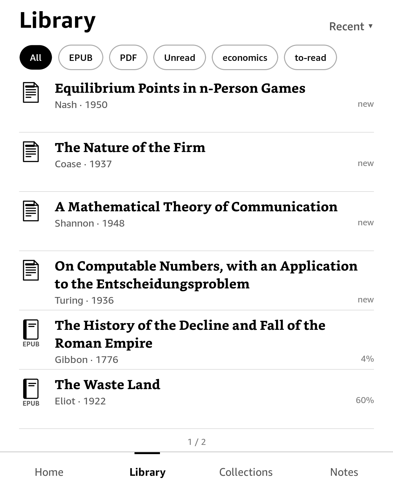

# Zotero for Kindle

Your Zotero library on a jailbroken Kindle: browse it, read EPUBs and PDFs, and highlight.
Highlights and notes sync both ways with Zotero.

> **Unofficial.** This is a personal project, built for my own use. It is not made or supported by Zotero or Amazon.
> It works on my Kindles. It may not work on yours.

  
  
  
  

  
  

## What it does

- Syncs your library from zotero.org: items, collections, tags and annotations.
- Library, collections and search (in the whole library or one collection, with recent searches), with offline use.
- Downloads books on demand, from Zotero storage or your WebDAV server.
- EPUB and PDF reader with fonts, sizes and margins, plus PDF margin trimming.
- Fast reading fonts (bold word beginnings) for EPUBs: Fast Serif, Fast Sans and Fast Mono.
- Footnotes in a pop-up, Back after a jump, bookmarks and Go to page.
- Collections pinned to the top with a long press.
- Mark as read: a Zotero tag (`read`, or one you choose) shown as "✓ Read" in lists, set from an item's long press or at
  the end of a book.
- Highlights and notes that show up in Zotero desktop, and the other way round.
- Optional landscape mode, with two columns on big screens.
- A native app with a Kindle-like look, made for e-ink.

## Requirements

- **A jailbroken Kindle** that can run scriptlets: `.sh` files in `documents/` show up in the library.
  Most jailbreaks provide this through the Universal Hotfix. See [kindlemodding.org](https://kindlemodding.org).
  Tested on a Paperwhite 5 (firmware 5.18.4) and a Kindle Scribe (5.16.8).
- **A Zotero account and an API key** from [zotero.org/settings/keys](https://www.zotero.org/settings/keys).
- **Your files in Zotero storage or on WebDAV**, the same place Zotero desktop syncs them to
  (*Settings → Sync → File Syncing*).

## Install

The easiest way is with an AI agent: connect the Kindle by USB, then give Claude Code, Codex or a similar agent this
prompt:

> Install Zotero for Kindle on my Kindle by following
> https://github.com/ievlevpn/zotero-for-kindle/blob/master/INSTALL-WITH-AI.md

To do it yourself, see [INSTALL.md](INSTALL.md). It amounts to copying two folders over USB.

**Updates:** from 0.2.0 on, use *Settings → Check for updates* on the Kindle. Releases are signed, and if a new
version doesn't start, the app goes back to the previous one. To get from 0.1.0 to 0.2.0, install over USB once.

## Building from source

The app is C++20 with cairo/pango, crengine (EPUB), MuPDF (PDF) and FBInk, built with Meson.

    meson setup build-desktop && meson test -C build-desktop   # desktop build and tests (macOS)
    ./build-desktop/zotero --device pw5                        # try it in a window (or --device scribe)
    tools/build-kindle.sh                                      # cross-build in the zk-kindlehf container
    tools/package.sh                                           # dist/zotero-for-kindle.zip
    tools/deploy.sh                                            # copy to a Kindle over USBNetwork (SSH)
    tools/release.sh 0.3.0 notes.md                            # a signed release (needs the signing key)

`tools/screenshots.sh` regenerates the screenshots above from a demo library of public-domain books.

## Licence

AGPL-3.0-or-later. An unofficial project for personal use, with no affiliation to Zotero or Amazon.
The Fast reading fonts are [Fast Font](https://github.com/chelaxian/Fast-Font) by Born2Root (MIT, see
`assets/fonts-fast/`).
Zotero is a trademark of the Corporation for Digital Scholarship. Kindle is a trademark of Amazon.
